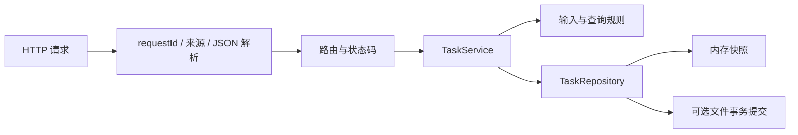

# Express API 架构与接口

## 为什么拆 app 与 server

createApp 接收仓库与 logger，不监听网络、不连接数据库、不写入数据。server.js 只负责配置、资源创建、监听和关闭，因此测试可以把应用交给 Supertest，不启动固定端口。

当前只有一组路由，保留在 app.js；路由数量明显增加后再拆 Router。不要为了层数而创建只转发一个函数的 Controller。

## HTTP 契约

创建只接受 title；修改只接受 title、completed 且至少一个字段。列表支持 completed=true/false、limit=1..100（默认20）、offset=0..1000000（默认0）。响应为 `{items,total,limit,offset}`。

400 输入无效，403 跨站/跨源请求，404 任务或路由不存在，409 超出容量，413 请求体过大，415 不支持内容类型，500 内部失败。每次请求生成服务端 requestId 并返回 X-Request-ID；日志只包含 method、path、status、耗时和 requestId，不记录正文或请求头。

## 存储策略

写操作进入同一 Promise 队列，先复制下一份数据，持久化成功后才替换内存。单次失败不会阻塞后续队列。读取返回对象副本，防止调用方修改仓库状态。文件持久化为 version=1 的 JSON，加载时校验数据和重复 id。

锁文件使用独占创建，保证同一数据文件不能被两个示例进程同时打开；它不是可自动恢复的分布式锁。后续接入数据库时应使用真正事务、唯一约束、迁移和连接池。

## 扩展建议

需要用户功能时先明确身份边界，再增加认证和授权；不能直接让所有用户共享本例的数据集。对接浏览器需要有意设计同源部署或受限 CORS。增加数据库不应把启动时 INSERT 逻辑放回路由模块。
